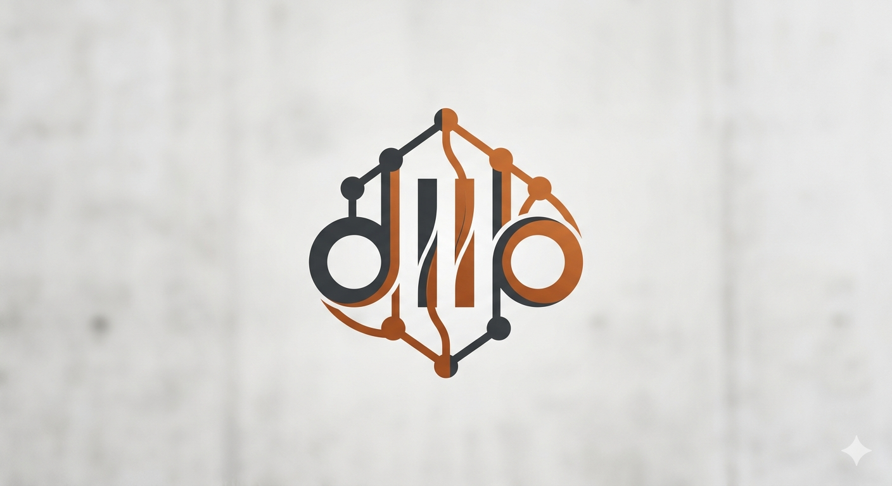
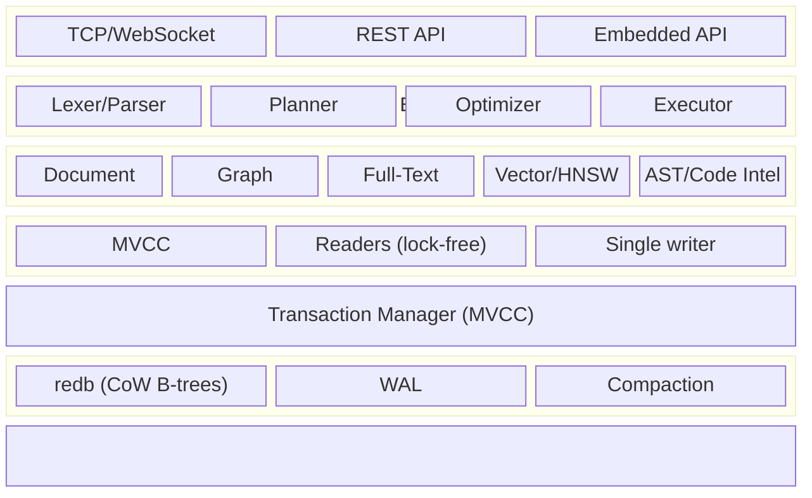

<p align="center">
  
</p>

<p align="center">
  <strong>A multi-model NoSQL database built from scratch in Rust.</strong><br/>
  Documents. Graphs. Full-Text Search. Vector Embeddings. One engine.
</p>

<p align="center">
  <a href="PLAN.md">Detailed Plan</a> &middot;
  <a href="docs/architecture.md">Architecture</a> &middot;
  <a href="docs/storage.md">Storage Engine</a> &middot;
  <a href="docs/crates.md">Crate Reference</a> &middot;
  <a href="#getting-started">Getting Started</a> &middot;
  <a href="#license">License</a>
</p>

---

> [!IMPORTANT]
> **Release Note (v1.2.0)**: `dllb` 1.2.0 adds plain JSON wire results, explicit bulk deletion, index discovery, server configuration flags, and storage/index correctness fixes. Review the breaking changes in [CHANGELOG.md](CHANGELOG.md) before upgrading.

### Modern Features (v1.0.0)
- **Zero-Copy & Zero-Dependency Engine**: Built on pure Rust `redb` for ACID transactions and thread-safe MVCC reads without dynamic C links.
- **Unified Key Encoding**: Maps document, graph, index, and metadata entries into a single sorted keyspace; scans use highly efficient binary prefix range checks.
- **Crash-Safe Storage**: redb's copy-on-write B-trees give ACID transactions and MVCC snapshots with no external dependencies.
- **AST & Code Intel Native**: Predefined schemas and a code-aware tokenization pipeline designed for source code analysis.
- **SQL AST Functions**: Native SQL extensions like `ast::complexity`, `ast::hash`, and `ast::similarity` to perform structural clone and pattern analyses directly inside the database.
- **Hybrid Search**: Fuses BM25 text relevance and HNSW approximate nearest-neighbor vector similarity with optional server-side metadata constraints.

## What is dllb?

**dllb** is a multi-model NoSQL database management system that natively supports
four data models in a single, unified engine:

- **Documents** -- schemaless or schemafull JSON/MessagePack records with
  secondary B-tree indexes
- **Native Graphs** -- first-class edges with properties, bidirectional
  traversal, BFS/DFS, path finding, and pattern matching
- **Full-Text Search** -- BM25-scored inverted indexes powered by
  [Tantivy](https://github.com/quickwit-oss/tantivy), with configurable
  analyzers and stemming
- **Vector Embeddings** -- HNSW approximate nearest neighbor index for dense
  vectors (cosine, L2, dot product), with SIMD-accelerated distance computation

All four models are stored as binary key-value pairs in a single sorted
keyspace backed by [redb](https://github.com/cberner/redb) (pure-Rust, ACID,
crash-safe, copy-on-write B-trees). Different "models" are simply different key
layouts and query patterns over the same byte stream.

### Why dllb?

Most real-world applications need more than one data model. A social network
needs documents (profiles), graphs (relationships), full-text (search), and
vectors (recommendations). The traditional answer is polyglot persistence --
stitching together MongoDB, Neo4j, Elasticsearch, and Pinecone. That means six
connection pools, six consistency models, six failure modes, and ETL pipelines
to keep them in sync.

dllb eliminates the seams. A single statement can fuse a full-text match with a
vector similarity search, and the same engine answers graph questions over the
same data:

```sql
-- BM25 + HNSW fused into one ranked list
HYBRID SEARCH ast_node TEXT source_text 'async trait'
               VECTOR source_embedding [0.12, -0.03, ...]
               ALPHA 0.6 WHERE kind = 'function' LIMIT 10;

-- Structural neighbours of a function, then their documents
SELECT ->calls->fn_node.name FROM ast_node:src%2Fquery.rs::parse/1;

-- Which functions are most depended upon?
GRAPH CENTRALITY calls INDEGREE LIMIT 20;
```

### Code Intelligence First-Class Citizen

dllb is designed from the ground up as a first-class store for **AST and
MetaAST embeddings** of source code. Each AST node (function, class, module,
trait) is a document. Structural relationships (call graph, containment,
imports, type references) are graph edges. Code embeddings (CodeBERT,
StarCoder, etc.) are vectors. Source text and docstrings are full-text indexed
with a code-aware tokenizer that understands camelCase/snake_case boundaries.

This enables queries like:

```sql
-- Functions structurally similar to a query embedding
VECTOR SEARCH ast_node source_embedding [0.1, -0.2, ...] K 10;

-- Structural clone detection inside the database
SELECT ast::similarity(ast_serialized, '{...}') FROM ast_node WHERE kind = 'function_def';

-- Containers that import a given module, then their contained functions
SELECT <-contains<-module.name FROM import:tokio;

-- Complexity ranking without leaving the database
SELECT name, ast::complexity(ast_serialized) FROM ast_node ORDER BY name;
```

## Architecture



### Concurrency and Durability

Concurrency is delegated to [redb](https://github.com/cberner/redb), which
provides MVCC snapshots for concurrent readers and a single serialized writer
per database file. dllb adds no lock of its own on the hot path: reads open a
read transaction directly, and writes go through `write_batch` so a
multi-key change (document + its index entries) commits atomically.

Analytics results (`GRAPH COMMUNITIES`, `PAGERANK`, `CENTRALITY`,
`COMPONENTS`) are cached and invalidated by a per-edge-table monotonic counter
that `EdgeStore` bumps on every mutation — see
[`crates/graph/src/store.rs`](crates/graph/src/store.rs).

> **Roadmap note.** An Erlang/OTP-style supervision tree built on
> [joerl](https://crates.io/crates/joerl) is planned for distributed
> clustering. `crates/storage/src/actor.rs` sketches a `StorageWriter`
> GenServer, but it is **not spawned** — the current runtime is a plain Tokio
> task per connection, and storage access is direct.

### Key Encoding

All data lives in a single sorted keyspace. Type tags in keys distinguish models:

| Tag | Byte | Purpose |
|-----|------|---------|
| `*` | 0x2A | Document record |
| `~` | 0x7E | Graph edge pointer |
| `+` | 0x2B | Index entry (B-tree, HNSW, full-text) |
| `!` | 0x21 | Metadata (schema, table definitions) |

Key structure:
`[namespace][0x00][database][0x00][table][tag][record_id][...extra]`

Graph traversals, document lookups, and index scans all reduce to the same
primitive: **prefix range scans** over contiguous byte slices.

## Project Structure

```
dllb/
  Cargo.toml              # Workspace manifest
  PLAN.md                 # Detailed implementation plan
  README.md               # This file
  crates/
    core/                 # RecordId, Value, Error, Schema, FieldType::Vector
    storage/              # KvStore trait, redb backend, WAL, key encoding
    document/             # Document model, CRUD, secondary indexes
    graph/                # Graph model, edge storage, traversal engine
    search/               # Tantivy integration, full-text index management
    vector/               # HNSW index, distance metrics, quantization
    code-intel/           # AST/MetaAST schemas, code-aware tokenizer
    query/                # Lexer, parser, planner, optimizer, executor
    server/               # TCP/WebSocket server (binary)
    cli/                  # Interactive REPL (binary)
```

## Technology Stack

| Component | Choice | Rationale |
|-----------|--------|-----------|
| Storage | [redb](https://github.com/cberner/redb) | Pure Rust, ACID, MVCC, crash-safe, zero C deps |
| Full-text | [Tantivy](https://github.com/quickwit-oss/tantivy) | Lucene-class, BM25, 15K+ stars, MIT |
| Actor system | [joerl](https://crates.io/crates/joerl) | Erlang/OTP patterns; used for the planned clustering layer |
| Async runtime | [Tokio](https://tokio.rs) | Industry standard |
| Serialization | MessagePack + JSON | Compact internal, readable external |
| Vector math | SIMD (planned) | Hardware-accelerated distance computation |

### Fast Installation

#### Option 1: Universal Shell Installer (Linux & macOS)
```bash
curl -fsSL https://raw.githubusercontent.com/Oeditus/dllb/main/install.sh | sh
```

#### Option 2: Docker
```bash
docker run -d --name dllb-server -p 3009:3009 ghcr.io/oeditus/dllb:1.2.0
```

#### Option 3: Docker Compose
```bash
git clone https://github.com/Oeditus/dllb.git
cd dllb/deploy
docker compose up -d
```

### Build from Source

#### Prerequisites

- Rust 1.89+ (edition 2024)
- Linux, macOS, or Windows

#### Build

```bash
git clone https://github.com/Oeditus/dllb.git
cd dllb
cargo build --release
```

#### Run the Server

```bash
cargo run --release -p dllb-server -- --bind 127.0.0.1:3009 --path dllb.redb
```

Every setting is also an environment variable, and flags take precedence:

| Flag | Env | Default |
|------|-----|---------|
| `--bind <ADDR>` | `DLLB_BIND` | `127.0.0.1:3009` |
| `--path <FILE>` | `DLLB_PATH` | `dllb.redb` |
| `--ns <NAME>` | `DLLB_NS` | `default` |
| `--db <NAME>` | `DLLB_DB` | `default` |
| `--sock <PATH>` | `DLLB_SOCK` | `dllb_<port>.sock` |

`dllb-server --help` prints the full reference and exits without opening a
database.

#### Run the CLI

```bash
cargo run --release -p dllb-cli -- --path dllb.redb --ns default --db default
```

The CLI opens the database file **embedded**, so `dllb-server` must not be
holding the same file. Useful in-REPL commands:

| Command | Description |
|---------|-------------|
| `.help` | Full grammar reference |
| `.indexes` | List every defined index, its kind, fields, and uniqueness |
| `.schema` | Explain the schemaless / schemafull split |
| `.quit` | Exit |

`dllb-cli --version` and `--help` work without opening a database.

### Run Tests

```bash
cargo test --workspace
```

## Query Language

dllb uses a SQL-like declarative language inspired by SurrealQL. The full
grammar is documented in `dllb-cli --help`; the essentials:

```sql
-- Documents
CREATE user:alice SET name = 'Alice', age = 30;
CREATE user:bob SET name = 'Bob' ON CONFLICT UPDATE SET age = 31;
SELECT name, age FROM user WHERE age > 25 ORDER BY age DESC LIMIT 10;
UPDATE user:alice SET age = 31;
DELETE user:alice;                       -- one record
DELETE user WHERE age < 18;              -- matching records
DELETE ALL FROM user;                    -- every record (explicit on purpose)

-- Counting
COUNT user;
COUNT user WHERE age > 25 GROUP BY city;

-- Graphs
RELATE user:alice->purchased->product:widget SET quantity = 2;
SELECT ->purchased->product.name FROM user:alice;
GRAPH PATH alice -> widget ON purchased;
GRAPH PAGERANK purchased LIMIT 10;
GRAPH COMMUNITIES purchased ALGORITHM louvain;
GRAPH COMPONENTS purchased;
GRAPH CENTRALITY purchased INDEGREE;
GRAPH EDGES purchased WHERE weight > 0.5;

-- Indexes
DEFINE INDEX by_age ON user FIELDS age;
DEFINE INDEX by_tenant_age ON user FIELDS tenant, age UNIQUE;
DEFINE FULLTEXT INDEX ft ON article FIELDS body ANALYZER english;
DEFINE VECTOR INDEX vec ON ast_node FIELDS source_embedding DIMENSION 768 METRIC cosine;
REMOVE INDEX by_age ON user;
COMPACT;

-- Full-text and vector search
SEARCH article body 'distributed consensus' LIMIT 10;
VECTOR SEARCH ast_node source_embedding [0.1, -0.2, ...] K 10;
HYBRID SEARCH article TEXT body 'consensus' VECTOR embedding [0.1, ...] ALPHA 0.6 LIMIT 10;

-- Output format
SELECT * FROM user OUTCOME CSV;
```

`SEARCH`, `VECTOR SEARCH`, and `HYBRID SEARCH` accept an optional `WHERE`
clause that post-filters the ranked hits.

## Roadmap

### Prototype (In Progress)

- [x] Project structure and workspace setup
- [x] Core types (RecordId, Value, Schema, Error)
- [x] KvStore trait and key encoding
- [x] redb backend implementation
- [x] Document CRUD with MessagePack serialization, schema validation, secondary indexes
- [x] Graph edge storage and traversal (bidirectional, multi-hop walk, filtered)
- [x] Tantivy full-text integration (BM25 scoring, language stemming, multi-index)
- [x] HNSW vector index (distance metrics, brute-force baseline, in-memory HNSW with recall tests)
- [x] AST/MetaAST code intelligence layer (46 MetaAST node types, code tokenizer, schemas, extraction)
- [x] Query parser and executor (tokenizer, recursive-descent parser, direct executor)
- [x] TCP server and CLI REPL (tokio TCP, line protocol, JSON responses, rustyline REPL)

### Future

- Reactivity (LIVE SELECT, events, changefeeds)
- Geo-spatial (R-tree, GeoJSON)
- Object-oriented concepts (inheritance, computed fields)
- Distributed clustering via joerl's EPMD-based node discovery

## Contributing

Contributions welcome. See [PLAN.md](PLAN.md) for the detailed technical plan
and current phase.

## License

MIT
